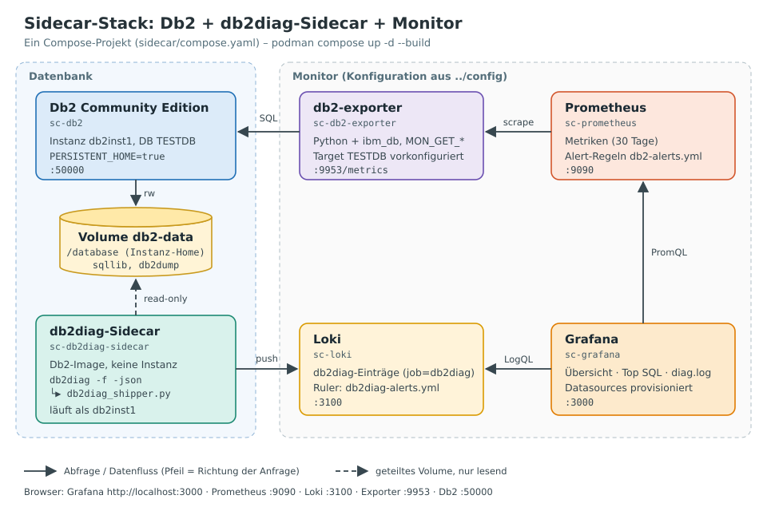

# Sidecar-Stack: Db2 + db2diag-Sidecar + Monitor

Ein eigenständiges Compose-Projekt im Ordner `sidecar/`. Ein Befehl startet alles, und es ist fertig eingerichtet:



- **db2** (`sc-db2`): Db2 Community Edition. Mit `PERSISTENT_HOME=true` liegt das Home von `db2inst1` mit `sqllib` und `db2dump` im Volume `db2-data`.
- **db2diag-sidecar** (`sc-db2diag-sidecar`): eigener Container für den Shipper. Er basiert auf demselben Db2-Image, damit `db2diag` vorhanden ist, startet aber keine Instanz. Er bindet `db2-data` **read-only** ein und betreibt den unveränderten `../diag-shipper/db2diag_shipper.py` mit `db2diag -f -json`. Labels, Felder und Dashboards sind also dieselben wie beim Shipper auf einem echten Db2-Server.
- **Monitor**: Exporter, Prometheus, Loki und Grafana mit den Konfigurationen aus dem Hauptprojekt (`../config`). Die Datenbank ist in `config/exporter/targets.yaml` schon als Target eingetragen.

## Start

Voraussetzungen wie im Hauptprojekt: Podman (rootful Machine unter Windows/macOS, weil Db2 `privileged` braucht) auf x86_64.

```bash
cd sidecar
podman compose up -d --build
podman logs -f sc-db2                  # warten bis "Setup has completed" (einige Minuten)
podman logs -f sc-db2diag-sidecar      # Shipper: "Erster Eintrag von db2diag, Felder: ..."
```

Eine `.env` ist nicht nötig. Für eigene Passwörter oder Ports: `cp .env.example .env`.

Testlast erzeugen, damit die Graphen Daten zeigen:

```bash
DB2_CONTAINER=sc-db2 ../scripts/workload.sh 100
```

## Aufrufen

| Dienst     | URL                           | Hinweis |
|------------|-------------------------------|---------|
| Grafana    | http://localhost:3000         | admin/admin. Dashboards *Db2 Übersicht*, *Db2 Top SQL*, *Db2 diag.log* |
| Prometheus | http://localhost:9090         | Status → Targets |
| Exporter   | http://localhost:9953/metrics | |
| Loki       | http://localhost:3100/ready   | |
| Db2        | localhost:50000               | `db2inst1` / Passwort aus `DB2_PASSWORD` |

Die Ports sind dieselben wie beim Hauptprojekt. Für einen Betrieb beider Stacks gleichzeitig die Ports in `.env` ändern. Die Containernamen beginnen mit `sc-`, deshalb gibt es keine Namenskonflikte.

## Der Sidecar im Detail

Das Image (`diag-sidecar/Containerfile`):
- Basis ist `DB2_IMAGE`, also dasselbe Image wie der Datenbank-Container. Die Links in `sqllib` zeigen dadurch auf eine passende Db2-Installation.
- Fehlt `python3` im Image, wird es beim Bauen nachinstalliert (`microdnf`/`dnf`/`yum`). Der Shipper braucht nur die Standardbibliothek ab Python 3.6.

Der Start (`diag-sidecar/start-shipper.sh`):
1. wartet, bis `/database/config/db2inst1/sqllib/db2profile` existiert, also das Db2-Setup die Instanz angelegt hat,
2. legt den Benutzer `db2inst1` mit derselben UID/GID wie `sqllib` im Volume an,
3. lädt `db2profile` und startet den Shipper als `db2inst1`.

Danach gilt alles, was im Haupt-README unter *db2diag.log* steht: Neustart von `db2diag`, wenn es abbricht (zum Beispiel solange `db2diag.log` noch nicht existiert), Puffer bei nicht erreichbarem Loki, Labels und Structured Metadata.

Einstellungen (Umgebungsvariablen im Service `db2diag-sidecar`): `LOKI_URL`, `DB2DIAG_CMD`, `HOST_LABEL`, `EXTRA_LABELS`, `LOG_LEVEL` sowie alle weiteren Variablen des Shippers (`BATCH_SIZE`, `LOKI_USERNAME` …). `DB2INSTANCE` und `DB2_INSTANCE_HOME` legen fest, welche Instanz verwendet wird.

Falls `db2diag` mit dem read-only eingebundenen Volume nicht zurechtkommt, sieht man das in `podman logs sc-db2diag-sidecar` (Zeilen `db2diag: ...`). Dann in `compose.yaml` beim Sidecar `:ro` entfernen.

## Aufräumen

```bash
podman compose down          # Container weg, Daten bleiben
podman compose down -v       # inklusive Volumes (Datenbank wird beim nächsten Start neu angelegt)
```
